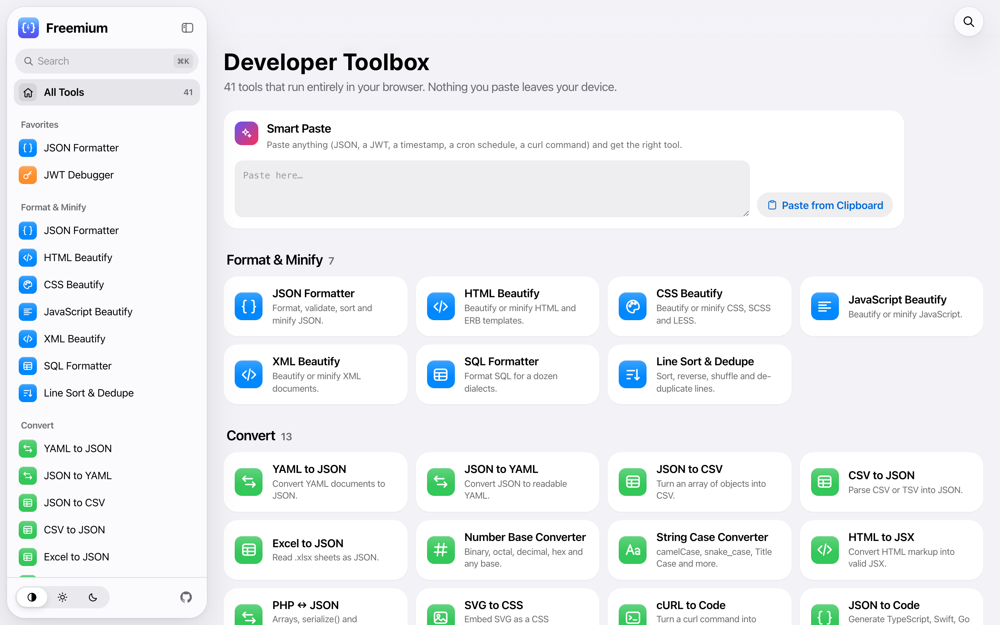
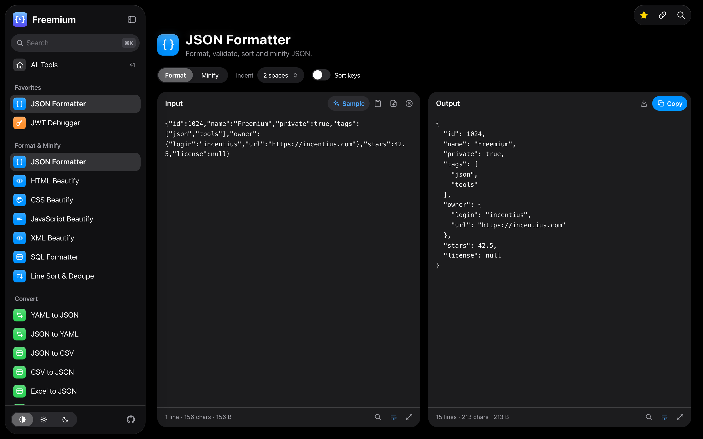
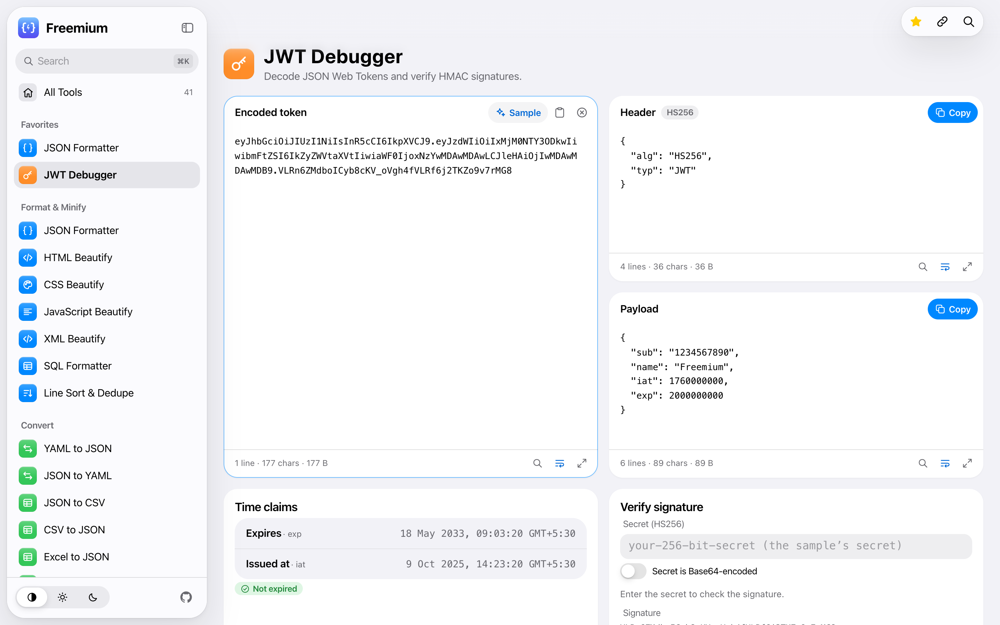
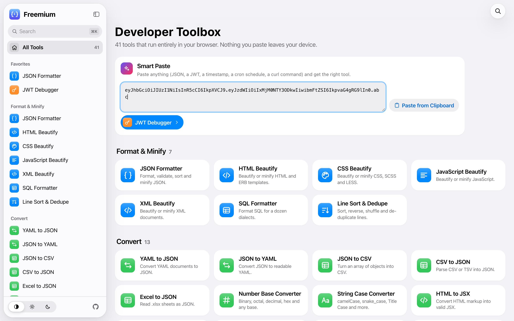
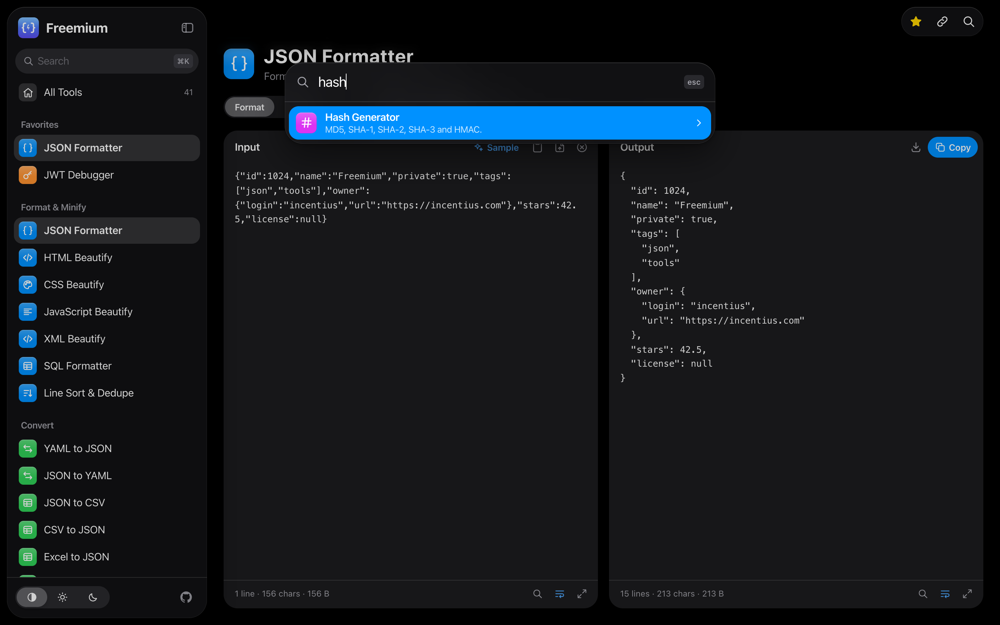
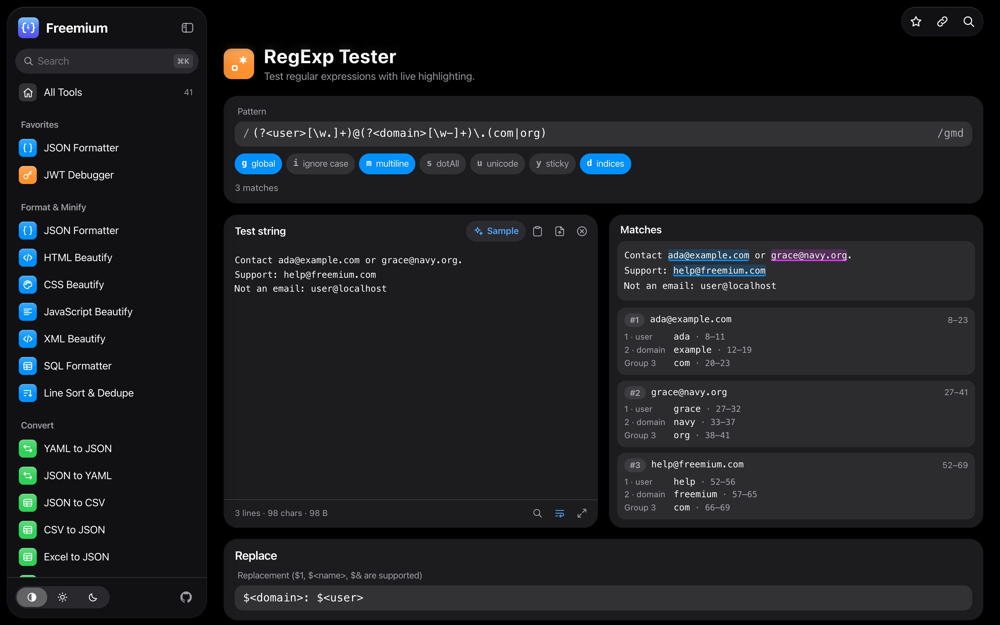
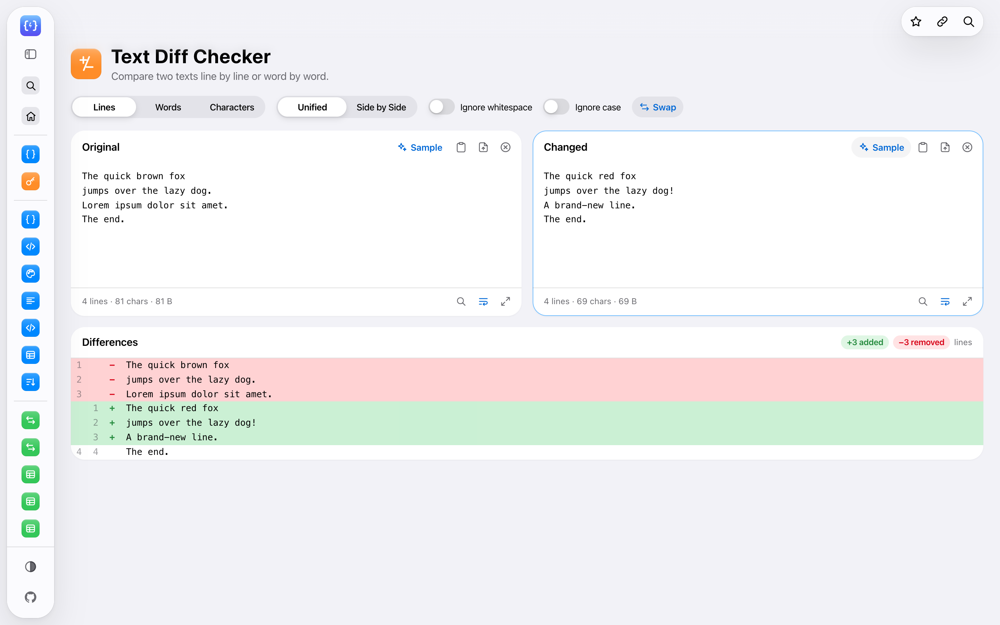
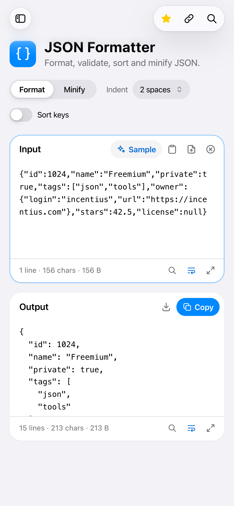
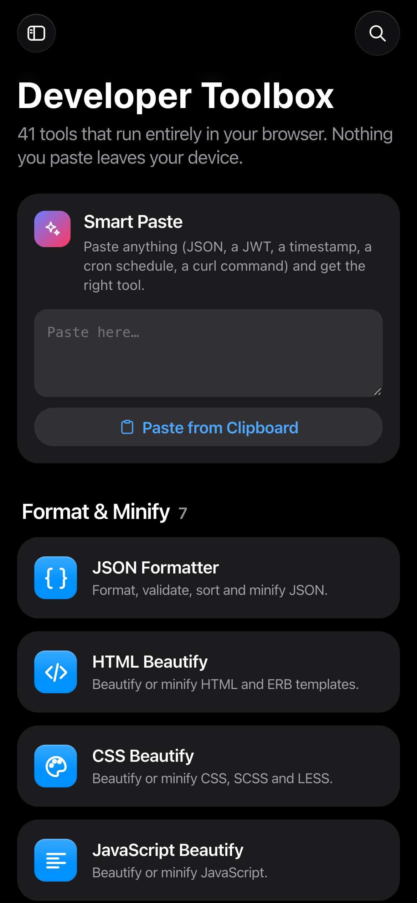

# Freemium

A developer toolbox: 41 tools that run entirely in your browser. Nothing you paste leaves your device.

The interface follows Apple's Human Interface Guidelines (iOS 27 / Liquid Glass): a floating glass sidebar on the navigation layer, plain content backgrounds, iOS text styles, system colors, light and dark appearances, and layouts that adapt by size class rather than device.

<p align="center">
  
</p>

<table>
  <tr>
    <td width="50%"></td>
    <td width="50%"></td>
  </tr>
  <tr>
    <td align="center"><sub><b>Dark mode</b>: JSON Formatter</sub></td>
    <td align="center"><sub><b>Light mode</b>: JWT Debugger</sub></td>
  </tr>
  <tr>
    <td></td>
    <td></td>
  </tr>
  <tr>
    <td align="center"><sub><b>Smart Paste</b> picks the right tool</sub></td>
    <td align="center"><sub><b>⌘K</b> to jump to any tool</sub></td>
  </tr>
  <tr>
    <td></td>
    <td></td>
  </tr>
  <tr>
    <td align="center"><sub><b>RegExp Tester</b> with live highlighting</sub></td>
    <td align="center"><sub><b>Mini sidebar</b>: an icon rail with labels</sub></td>
  </tr>
</table>

<p align="center">
  
  &nbsp;&nbsp;
  
</p>

## Tools

**Format & Minify:** JSON Formatter · HTML Beautify (incl. ERB) · CSS / SCSS / LESS Beautify · JavaScript Beautify · XML Beautify · SQL Formatter · Line Sort & Dedupe

**Convert:** YAML ↔ JSON · JSON ↔ CSV · Excel to JSON · Number Base Converter · String Case Converter · HTML to JSX · PHP ↔ JSON (serialize / unserialize) · SVG to CSS · cURL to Code · JSON to Code (TypeScript, Swift, Go, Kotlin, Rust) · Hex ↔ ASCII

**Inspect & Debug:** Unix Time Converter · JWT Debugger · RegExp Tester · HTML Preview · Text Diff · String Inspector · Markdown Preview · Cron Job Parser · Color Converter · URL Parser

**Generate:** UUID / ULID · Lorem Ipsum · QR Code (generate and read) · Hash Generator · Random String

**Encode & Decode:** Base64 String · Base64 Image · URL Encode · HTML Entities · Backslash Escape · Certificate Decoder & Validator (X.509: chain signatures, trusted root, hostname, private-key match)

### App features

- **Smart Paste** on the home page detects what you pasted (JWT, JSON, timestamp, cron, curl, color, UUID, certificate…) and opens the right tool with your input already filled in.
- **⌘K / Ctrl+K** searches all tools from anywhere. **⌃⌘S** switches the sidebar between full and a mini icon rail.
- Every editor pane has **Find** (⌘F, with match count and case toggle), **wrap**, and **expand to full window**. HTML Preview also has true full screen, phone/tablet widths, and opening `.html` files.
- **Favorites** and **Recents**, plus live conversion as you type, Paste / Open file / drag-and-drop on every input, and Copy / Download on every output.
- Light, dark, or system appearance.

### Accessibility

- WCAG AA contrast in both appearances. Secondary labels are tuned darker than the kit defaults so small text reaches 4.5:1.
- Supports Increase Contrast (`prefers-contrast`), Reduce Transparency, and Reduce Motion.
- Text sizes are in `rem`, so browser text size and zoom (up to 200%) are respected; pinch-zoom is enabled.
- Full keyboard use: skip link, visible focus rings, arrow keys in segmented controls, and a combobox-pattern command palette.
- Hit targets grow to 44 pt on touch screens. State is never conveyed by color alone.

## Development

Requires Node 22.22+ or 24+ (see `.nvmrc`).

```bash
npm install
npm run dev      # quasar dev
npm run build    # quasar build → dist/spa
```

Stack: Quasar CLI (`@quasar/app-vite` 3) · Vite 8 · Vue 3.5 · vue-router 5.

### Deploying to Netlify

`npm run build` writes a ready-to-deploy folder at `dist/spa`. Drag that folder onto Netlify (Deploys → drag and drop), or connect the repo and `netlify.toml` will run the build on Node 24.

The build also runs `scripts/seo.js`, which adds the following for search engines and link previews:

- a pre-rendered `<tool>.html` per tool, with its own title, description, canonical URL, Open Graph/Twitter tags and JSON-LD
- `sitemap.xml` and `robots.txt`
- `_redirects` (copied from `public/`), which keeps SPA routing and old URLs working, including on drag-and-drop deploys

After deploying, submit `https://freemium.incentius.com/sitemap.xml` in Google Search Console. If the site lives on another domain, change `SITE_URL` in `src/tools/seo.js`.

### Project layout

```
src/
  tools/registry.js        every tool: route, title, icon, keywords, Smart Paste detector
  tools/seo.js             search titles/descriptions per tool (runtime + build)
  css/app.scss             design tokens (iOS 27 UI Kit colors, materials, text styles)
  components/
    TransformTool.vue      live input → output engine used by most tools
    ToolPage.vue, ToolHeader.vue, CodePane.vue, OptionControls.vue
    AppSidebar.vue, CommandPalette.vue, AppToasts.vue
    ui/Segmented.vue, ui/Toggle.vue
  pages/
    HomePage.vue           Smart Paste and the tool grid
    tools/*.vue            one file per tool
```

### Adding a tool

1. Add an entry to `src/tools/registry.js` (id, title, subtitle, category, icon, keywords, component, and optionally `detect`).
2. Create `src/pages/tools/YourTool.vue`. For text in → text out, wrap `TransformTool` and pass a `transform(input, options)` function. Throw an `Error` to show a message inline.

The route, sidebar entry, search result, and home tile are generated from the registry entry.

## Third-party data

The Certificate Validator ships Mozilla's trusted root store (`src/tools/data/cacert.pem`, from [curl's CA extract](https://curl.se/docs/caextract.html), MPL-2.0). To refresh it, run `curl -o src/tools/data/cacert.pem https://curl.se/ca/cacert.pem`.

## Contributing

1. Fork the repository.
2. Create your feature branch (`git checkout -b feature/YourFeature`).
3. Commit your changes.
4. Open a pull request.

## Created by Incentius

If you are seeking to leverage innovative technologies to create a custom application or transform your business processes, we invite you to reach out to [Incentius](https://www.incentius.com/).

## License

MIT. See [LICENSE](LICENSE).
